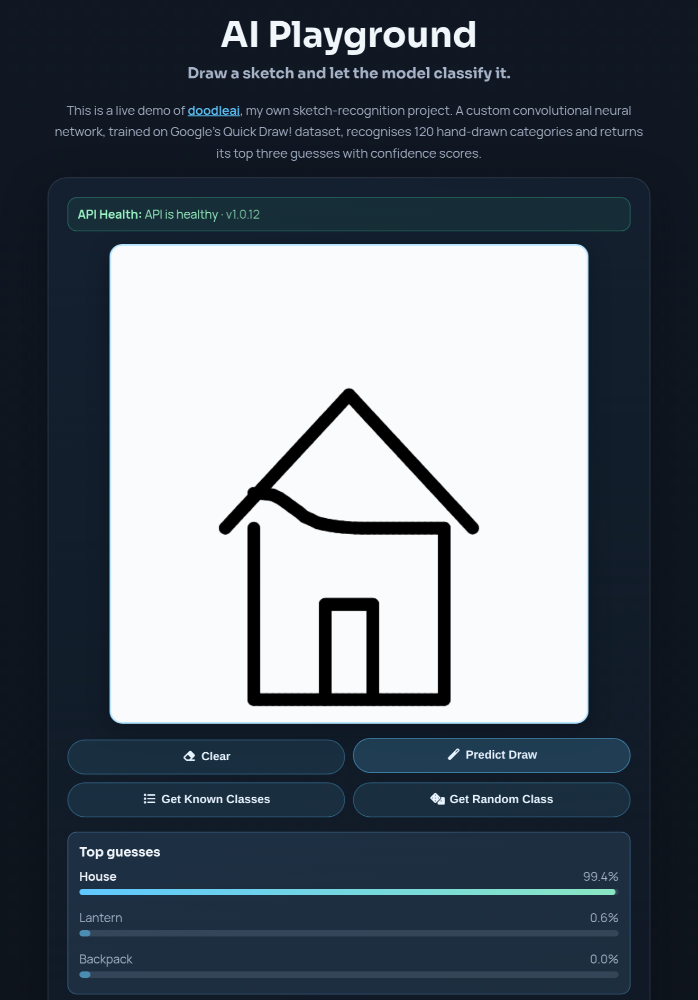

# AI Drawing Classifier API

[](https://github.com/alanszuster/doodleai/actions/workflows/deploy-hf.yml)
[](https://github.com/alanszuster/doodleai/releases)
[](LICENSE)

**Try it live: [alanszuster.dev, AI Playground](https://www.alanszuster.dev/#ai-playground)**

REST API for recognising hand-drawn sketches. A convolutional neural network trained on Google's
[Quick, Draw!](https://github.com/googlecreativelab/quickdraw-dataset) dataset classifies a drawing
into one of 120 categories and returns the top three guesses. It powers the AI Playground on
[alanszuster.dev](https://www.alanszuster.dev).

<p align="center">
  
</p>

## Stack

- Python 3.12, Flask, gunicorn
- TensorFlow / Keras
- uv, Docker
- GitHub Actions, deployed to Hugging Face Spaces
- Training on a free Kaggle GPU, driven from a CLI

## Endpoints

| Endpoint | Purpose |
|---|---|
| `POST /predict` | Classify a drawing (PNG) |
| `GET /classes` | Supported categories |
| `GET /get_random_word` | A random category |
| `GET /status` | Status, build version and served model |
| `GET /health` | Public liveness probe |

Everything except `/` and `/health` requires authentication.

## Run locally

```bash
uv sync
AUTH_ALLOW_API_KEY=true AI_API_KEY=dev-key uv run python src/app.py   # http://localhost:5000
```

Or with Docker:

```bash
docker build -t doodleai .
docker run -p 8080:8080 -e AUTH_ALLOW_API_KEY=true -e AI_API_KEY=dev-key doodleai
```

Tests and checks:

```bash
uv run pytest
uv run ruff check . && uv run ruff format --check .
```

## Training

`model/training/` holds the whole pipeline: data preparation, training, evaluation, experiment
records and the gate that decides which model reaches production. See
[model/training/README.md](model/training/README.md).

## Repository layout

```
src/            API (Flask)
model/          served model (artifacts/) and training pipeline (training/)
tests/          API and pipeline tests
docker/         local docker-compose
Dockerfile      image for Hugging Face Spaces
```

## Delivery

Every push to `main` runs lint, tests, an image build and vulnerability scans, then deploys to
[Hugging Face Spaces](https://huggingface.co/spaces/alanoee/doodleai) and publishes a versioned
release (`v1.0.N`).

## Data and attribution

The model is trained on [Quick, Draw!](https://github.com/googlecreativelab/quickdraw-dataset), a
dataset of drawings collected by Google and made available under the
[CC BY 4.0](https://creativecommons.org/licenses/by/4.0/) license. The drawings are rendered and
resized for training; this project is not endorsed by Google. The code is MIT licensed; the trained
model is derived from CC BY data, so give credit to the dataset when you redistribute it.

## License

MIT License - see LICENSE for details.
