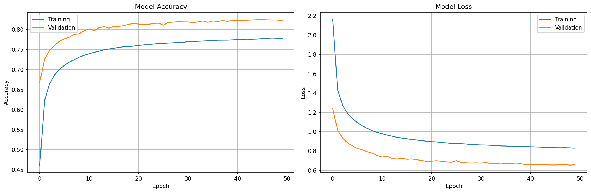

# AI Drawing Classifier API

REST API for real-time hand-drawn sketch recognition using a convolutional neural network trained on the Google Quick Draw! dataset.

## Features

- Custom CNN architecture for sketch classification
- 120 supported drawing categories
- Returns top-3 predictions with confidence scores
- Authentication with short-lived OIDC tokens (Vercel), no shared secret; static API key only as an optional fallback
- Rate limiting per endpoint
- Deployed on Hugging Face Spaces, Docker support included

## Supported Categories

120 categories across 8 groups:
**Animals**: bear, bee, butterfly, cat, cow, crab, camel, dog, dolphin, duck, elephant, fish, flamingo, frog, giraffe, hedgehog, horse, kangaroo, lion, monkey, octopus, owl, panda, penguin, pig, rabbit, shark, sheep, snake, spider, tiger, whale, zebra
**Food**: apple, banana, birthday cake, bread, carrot, cookie, donut, grapes, hamburger, hot dog, ice cream, broccoli, mushroom, pear, pineapple, pizza, strawberry, watermelon
**Vehicles**: airplane, bicycle, bus, car, firetruck, helicopter, motorbike, cruise ship, sailboat, submarine, train, truck
**Objects**: backpack, book, camera, chair, clock, computer, cup, drums, fork, guitar, hammer, hat, key, knife, lantern, microphone, pencil, piano, scissors, shoe, sword, umbrella
**Nature**: cloud, campfire, flower, leaf, lightning, moon, mountain, rainbow, snowflake, star, sun, tree
**Buildings**: bridge, castle, door, fence, house, lighthouse, windmill
**Body**: ear, eye, face, hand, nose, tooth
**Misc**: circle, crown, diamond, bowtie, hot air balloon, lollipop, skull, stop sign, tornado, cactus

## Quick Start

### Prerequisites

- Python 3.10+
- TensorFlow CPU 2.x

### Installation

```bash
git clone <repository-url>
cd doodleai
pip install -r requirements.txt
```

### Run the API

```bash
AI_API_KEY=your-secret-key python app.py
```

The API will be available at `http://localhost:5000`.

### Run with Docker

```bash
docker build -t doodleai .
docker run -p 8080:8080 -e AI_API_KEY=your-secret-key doodleai
```

Or using Docker Compose:

```bash
AI_API_KEY=your-secret-key docker compose up
```

## Authentication

Protected endpoints (`/predict`, `/classes`, `/get_random_word`) accept either:

1. **A Vercel OIDC token** (preferred): `Authorization: Bearer <jwt>`. The token is issued to the
   website's server functions, lives for a short time and is verified against Vercel's public keys
   (RS256 only, with `iss`, `aud`, `exp`, `iat`, `sub` required). Only the listed subjects are
   allowed, e.g. the production environment of one project. There is no secret to store or rotate.
2. **A static API key** (transition only): `x-api-key: <key>`, compared in constant time. Disable it
   with `AUTH_ALLOW_API_KEY=false` once the website uses OIDC, then delete `AI_API_KEY`.

`/` and `/health` are public. OIDC is enabled only when issuer, audience and allowed subjects are
all set, so a half-finished configuration never lets anyone in.

| Variable | Example | Purpose |
|---|---|---|
| `OIDC_ISSUER` | `https://oidc.vercel.com/<team-slug>` | Token issuer (also where the public keys are fetched) |
| `OIDC_AUDIENCE` | `https://vercel.com/<team-slug>` | Expected `aud` claim |
| `OIDC_ALLOWED_SUBJECTS` | `owner:<team>:project:<project>:environment:production` | Comma-separated exact `sub` values |
| `AI_API_KEY` | – | Legacy static key (transition only) |
| `AUTH_ALLOW_API_KEY` | `false` | Turns the legacy key off |

Other protections: request bodies are capped at 1 MB, images larger than 2048 px per side are
rejected before decoding, malformed input returns `400` and internal errors are logged, never
returned to the client.

## API Endpoints

Endpoints other than `/` and `/health` require authentication (see above).

### GET /

Returns API metadata and available endpoints.

```json
{
  "name": "AI Drawing Classifier API",
  "version": "1.0",
  "endpoints": {
    "POST /predict": "Classify a drawing image",
    "GET /classes": "Get list of supported classes",
    "GET /health": "Check API health"
  }
}
```

### POST /predict

Classifies a base64-encoded drawing. Rate limit: 10 requests/minute.

Request:
```json
{
  "image": "data:image/png;base64,<base64-encoded-image>"
}
```

Response:
```json
{
  "predictions": [
    {"class": "cat", "confidence": 92.1},
    {"class": "dog", "confidence": 5.3},
    {"class": "bird", "confidence": 1.8}
  ],
  "success": true
}
```

### GET /classes

Returns all supported drawing categories.

### GET /health

Returns API and model status.

### GET /get_random_word

Returns a random category for drawing challenges.

## Usage Example

```python
import requests
import base64

with open('drawing.png', 'rb') as f:
    image_data = base64.b64encode(f.read()).decode()

response = requests.post(
    'http://localhost:5000/predict',
    headers={'Authorization': 'Bearer <oidc-token>'},  # or {'x-api-key': ...} during transition
    json={'image': f'data:image/png;base64,{image_data}'}
)

result = response.json()
print(result['predictions'][0])
```

## Training Your Own Model

Training scripts are in the `scripts/` directory. See `scripts/README.md` for details.

```bash
# 1. Download and preprocess data
python scripts/prepare_data.py

# 2. Train the model
python scripts/train_model.py
```

## Training History



## Technical Details

- **Architecture**: 4-layer CNN (32→64→128→256 filters) with BatchNormalization, GlobalAveragePooling2D, and online data augmentation (rotation, translation, zoom)
- **Input**: 28×28 grayscale images (resized from canvas, colors inverted to match training format)
- **Dataset**: Google Quick Draw! numpy bitmap format, 15,000 samples per class
- **Accuracy**: ~72% across 120 classes
- **Confidence**: top-3 predictions returned per query
- **Framework**: TensorFlow/Keras
- **Model size**: ~5.9 MB
- **Inference time**: <100ms
- **API**: Flask with rate limiting and CORS

## Running Tests

```bash
AI_API_KEY=test-key pytest tests/ -v
```

## Deployment

### Hugging Face Spaces (primary)

The API is hosted on [Hugging Face Spaces](https://huggingface.co/spaces/alanoee/doodleai) as a Docker space. Every push to `main` triggers an automatic deploy via GitHub Actions.

Required environment variables on the Space (Settings → Variables and secrets):
- `OIDC_ISSUER`, `OIDC_AUDIENCE`, `OIDC_ALLOWED_SUBJECTS` - OIDC verification (see [Authentication](#authentication))
- `AI_API_KEY` - legacy API key (transition only; remove after the switch)
- `AUTH_ALLOW_API_KEY` - set to `false` to refuse the legacy key
- `ADDITIONAL_ORIGINS` - comma-separated list of extra allowed CORS origins (the website's domains are built in)

To deploy your own instance:
1. Fork this repository
2. Create a Hugging Face Space (Docker SDK)
3. Add `HF_TOKEN` secret to your GitHub repository
4. Push to `main`

### Google Cloud Run

A manual Cloud Run deployment workflow is also available in `.github/workflows/deploy-gcp.yml`.

## License

MIT License - see LICENSE for details.
